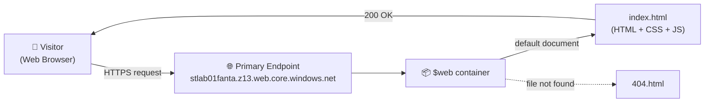
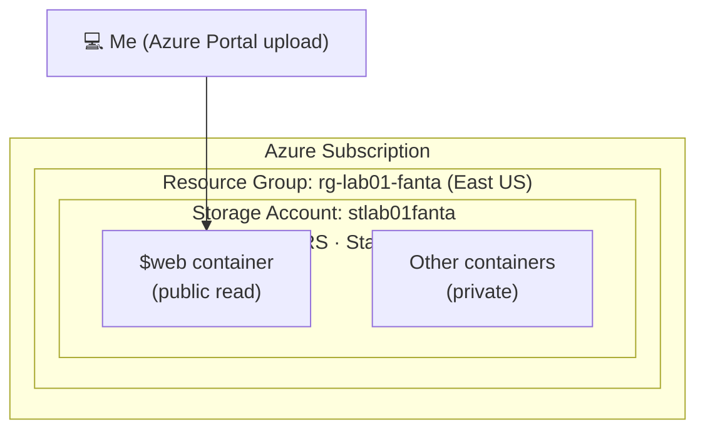

# ☁️ Azure Static Website: Quote of the Day
**Azure Blob Storage · Static Website Hosting · Serverless**

A public "Quote of the Day" website hosted on Azure Blob Storage, with no virtual machines, no web server, and no operating system to patch. I upload the files, and Azure serves them over HTTPS.

| | |
|---|---|
| **Cloud** | Microsoft Azure |
| **Services** | Storage Account (Blob), Resource Group |
| **Site** | HTML / CSS / JavaScript |
| **Live site** | [stlab01fanta.z13.web.core.windows.net](https://stlab01fanta.z13.web.core.windows.net/) |
| **Author** | Fanta Amouzougan |

### 🎥 Watch me build this
👉 `<your Loom link>`

---

## 📌 Overview

Hosting a website traditionally means a virtual machine (VM), a web server like NGINX or IIS, an operating system to patch, and a network to secure. Azure Blob Storage's static website feature removes all of that: you upload files, and Azure serves them directly.

Instead of the lab's default "Hello from the Cloud" page, I built an interactive Quote of the Day site to show the same hosting model can serve a real, animated page.

**What it demonstrates:**

- Resource organization and lifecycle control with Resource Groups
- Storage Account provisioning and redundancy selection
- Static website hosting and the auto-provisioned `$web` container
- Custom index and error (404) documents
- Client-side JavaScript running on a serverless host

---

## 🏗️ Architecture

### Request flow



> **Key insight:** There is no compute layer. No VM and no App Service sit between the visitor and the files. Azure serves the blob directly, and the visitor's browser runs the JavaScript. That is what makes this "serverless."

### Resource hierarchy



The trust boundary sits at the endpoint: everything inside `$web` is readable by anyone on the internet. Enabling static website hosting does not change access on any other container in the account.

### Repository structure

```
lab-01-azure-static-website/
│
├── index.html     # Quote of the Day site (HTML + CSS + JS)
├── 404.html       # Custom error page
└── README.md
```

---

## ⚙️ Tech stack

- Microsoft Azure Blob Storage (static website hosting)
- Azure Resource Groups
- Azure Portal
- HTML / CSS / JavaScript

---

## 🚀 Part 1: Deployment

### Naming convention

| Resource | Value | Constraints |
|---|---|---|
| Resource Group | `rg-lab01-fanta` | Prefix shows the resource type at a glance |
| Region | East US | Keep everything in one region |
| Storage Account | `stlab01fanta` | Globally unique, 3 to 24 characters, lowercase letters and numbers only |

Storage account names become part of a public web address (`stlab01fanta.blob.core.windows.net`), which is why they must be unique across all of Azure, not just your subscription.

### Steps

**1. Create the Resource Group**
Azure Portal → Resource groups → **+ Create** → name `rg-lab01-fanta`, region **(US) East US** → Review + create → Create.

> A Resource Group is a lifecycle boundary, not just a folder. One delete removes the entire lab.

**2. Create the Storage Account**
Storage accounts → **+ Create**:

| Setting | Value | Why |
|---|---|---|
| Resource group | `rg-lab01-fanta` | Keeps the lifecycle contained |
| Performance | Standard | Premium is unnecessary for small static files |
| Redundancy | Locally-redundant storage (LRS) | 3 copies in one datacenter, the cheapest option |

> **Redundancy note:** LRS survives a failed drive or rack, but not a full datacenter outage. A production site would use ZRS (copies across zones) or GRS (copies in a second region). LRS is chosen here for cost.

**3. Enable static website hosting**
Storage Account → Data management → **Static website** → Enabled
Index document: `index.html` · Error document: `404.html` → Save

Azure creates the `$web` container automatically and shows the **Primary endpoint**. That URL is the public address of the site.

**4. Upload and validate**
Containers → `$web` → **Upload** → select `index.html` and `404.html` → check **Overwrite if files already exist** when replacing a version → Upload.

Open the Primary endpoint in a browser. The Quote of the Day page loads. Visiting a path that does not exist loads the custom 404 page.

---

## ✨ Part 2: What I built

| Feature | How it works |
|---|---|
| Daily quote | JavaScript picks a quote from the current date, so it stays the same all day and changes daily |
| New quote button | Swaps in a random quote with a blur and fade animation |
| Mood buttons (chill, focused, hype, soft) | Update CSS variables to shift the pink and gray theme |
| Interactive effects | A glow follows the mouse, and a ring ripples on each click |
| Floating background | Blurred color shapes drift using CSS animations |

All three languages live in one `index.html` file. HTML is the structure, CSS (inside `<style>`) is the styling, and JavaScript (inside `<script>`) is the behavior. It still counts as a static site, because Azure only hands over the file. The browser runs the code.

---

## 💡 What I learned and what I'd improve next

**What I learned:** "Static" describes the server, not the page. A static site can be fully interactive, because the interactivity runs in the visitor's browser, not in Azure.

**What I'd improve next:** Every change to the site meant uploading the file again by hand and checking Overwrite. The next step is a CI/CD pipeline with GitHub Actions, so pushing code to this repository updates the live site automatically, with no Portal and no manual upload.

| | Today | With GitHub Actions |
|---|---|---|
| How a change goes live | Manual upload in the Portal | `git push` |
| Risk of uploading the wrong file | Possible | Pipeline uploads from one folder only |
| History of changes | None in Azure | Every change is a commit |

---

## 🧹 Cleanup

Deleting the resource group removes the storage account and every file in it in one action:
Resource groups → `rg-lab01-fanta` → **Delete resource group** → type the name to confirm.

> I'm keeping this site live as part of my portfolio.

---

## 👩🏾‍💻 Author

**Fanta Amouzougan**

- GitHub: [github.com/Fantabeser](https://github.com/Fantabeser)
- LinkedIn: [linkedin.com/in/fanta-amouzougan-bb5b78252](https://www.linkedin.com/in/fanta-amouzougan-bb5b78252)

---

## 📚 References

- [Static website hosting in Azure Storage](https://learn.microsoft.com/azure/storage/blobs/storage-blob-static-website)
- [Azure Storage redundancy](https://learn.microsoft.com/azure/storage/common/storage-redundancy)
- [Manage Azure resource groups](https://learn.microsoft.com/azure/azure-resource-manager/management/manage-resource-groups-portal)
- [Storage account overview and naming](https://learn.microsoft.com/azure/storage/common/storage-account-overview)
